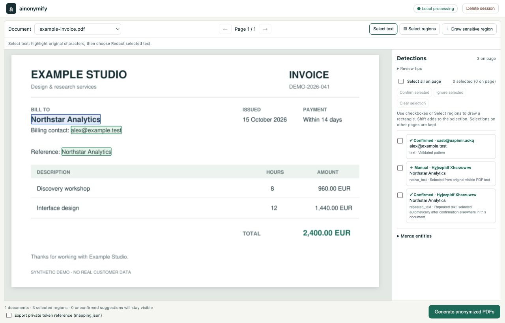
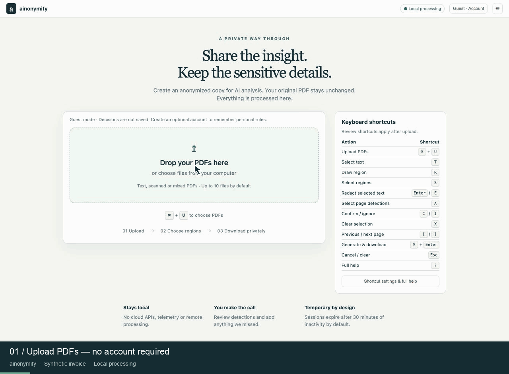

<p align="center">
  <a href="https://github.com/qbnm/ainonymify">
    
  </a>
</p>

<h1 align="center"><a href="https://github.com/qbnm/ainonymify">ainonymify</a></h1>

<p align="center"><strong>Local PDF anonymization for sharing documents with external AI tools.</strong></p>

<p align="center">
  <a href="LICENSE"></a>
  <a href="#local-development-and-verification"></a>
  <a href="#quick-start"></a>
  <a href="composer.json"></a>
  <a href="#quick-start"></a>
  <a href="#privacy-design-and-limitations"></a>
  <a href="https://github.com/qbnm/ainonymify/commits"></a>
</p>

ainonymify is a self-hosted application for Docker hosts and Synology NAS devices. Upload PDFs, review sensitive text, and download anonymized copies. Your original files stay unchanged. Processing happens locally, without AI services, cloud APIs, telemetry, CDNs, or runtime downloads.

**Only selected regions are anonymized. Inspect the exported PDF before sharing it. Keep the optional `mapping.json` private.**

## Preview



<details>
<summary>Watch text selection and automatic repeat detection (10 seconds)</summary>

Select text in the PDF, confirm its type, and matching occurrences in that document are selected automatically.



</details>

*The screenshot and animation use a synthetic invoice with fictional details. The document remains readable during review; selected regions are replaced when you generate the anonymized PDF.*

## Features

- Electronic, scanned, and mixed PDFs, with independent local OCR on every page.
- Compact document workspace: small header, large PDF preview, narrow Detections sidebar, and automatic preview scaling when the window changes width.
- Direct character selection in electronic PDFs, plus rectangle selection for scanned content and manual corrections.
- Automatic selection of repeated text across all pages of the current PDF after confirmation.
- Bulk confirm/ignore actions in Detections or through rectangle selection on the page.
- Keyboard shortcuts with in-app help and an option to disable single-key commands.
- A movable **Review sensitive region** dialog; drag its title bar or use the arrow keys while the move handle is focused. Shift moves farther; Home centers it.
- Replacement strings that preserve character count, uppercase/lowercase letters, digits, punctuation, whitespace, and line breaks.
- Automatic download after successful generation: a PDF for one document, a ZIP for multiple documents.
- An optional private reference linking replacements to original values.
- Temporary sessions with automatic expiry and manual deletion.
- Optional local accounts with personal text labels and remembered Confirm / Ignore decisions; guest mode remains available.

## Quick start

```sh
git clone https://github.com/qbnm/ainonymify.git
cd ainonymify
cp .env.example .env
# Edit .env: set APP_USERNAME and a strong APP_PASSWORD.
docker compose up -d --build
```

Open [ainonymify on localhost](http://127.0.0.1:8765) and sign in with the credentials from `.env`. Missing credentials and the example password `change-me` prevent startup.

Builds and dependency installation require Internet access; document processing does not. Docker Compose runs `composer install` in a dedicated image build stage. PDF.js and its resources are installed from `composer.lock` and published to `frontend/vendor/pdfjs`; the running application serves them locally without a CDN or dependency downloads.

The default container runs as a non-root user with a read-only filesystem, RAM-backed `/tmp`, dropped capabilities, and a loopback-only port binding: `127.0.0.1:8765`. No document volume is mounted. A separate `account-data` volume stores optional personal accounts and rules in SQLite at `/data/accounts.sqlite3`; PDFs and generated outputs stay temporary. Default limits are 3 GiB RAM, two CPUs, and 1.5 GiB temporary storage. Large scans may need more resources. Processing is serialized in one application process.

### Update or stop

```sh
git pull
docker compose up -d --build
```

To stop the application:

```sh
docker compose down
```
 **Recreating or stopping the container deletes active sessions and their uploaded documents, selections, and generated results.** Download anything you need first. Changes to files copied into the image, including the frontend, require an image rebuild.

### Synology DSM / Container Manager

1. Copy the repository to a NAS folder such as `/volume1/docker/ainonymify`.
2. Copy `.env.example` to `.env` and set credentials.
3. In Container Manager, create a **Project** using that folder and `compose.yml`, then build/start it. Older DSM Docker versions without Compose project support can use Docker Compose through SSH.
4. Configure Synology Reverse Proxy with an HTTPS hostname pointing to `http://127.0.0.1:8765`. Keep application authentication enabled. A proxy in another container needs a suitable private-network or host endpoint.
5. Open the HTTPS hostname. Restrict access to trusted users; do not expose the service directly to the public Internet.

For direct trusted-LAN access, change the port binding to your NAS LAN IP, for example `192.168.1.20:8765:8000`. Use HTTPS through a reverse proxy when credentials or documents traverse the LAN: HTTP Basic authentication does not encrypt transport. Restrict access with the NAS firewall.

An arm64 image build and an upload → OCR → select → anonymize workflow in the read-only container have been tested. An actual Synology installation and an amd64 build still need validation. This is an MVP, not an audited privacy product.

## Review and export

1. Drop one or more PDFs. Encrypted PDFs and PDFs containing embedded attachments are rejected.
2. Analysis reads available text and independently OCRs the rendered pixels on every page, including pages with an existing OCR layer.
3. Review all pages in the large PDF preview. Solid boxes are confirmed, dashed boxes require a decision, and ignored regions remain visible. **Review tips** explains the sidebar states; **Merge entities** expands the merge controls.
4. Confirm, ignore, or add regions using the controls below. The review dialog lets you correct the original reference value, change its type, or split an occurrence into a separate entity.
5. Click **Generate anonymized PDFs**. Confirmed regions are redacted; pending suggestions are automatically ignored. All unselected content stays visible. There is no page-review checkbox.
6. Selected-region checks must pass before a download starts. If a verification warning appears, inspect the listed regions, correct or enlarge them, and generate again.
7. Inspect the downloaded PDFs before sharing only those anonymized copies with an external AI.

### Select text or draw regions

For an electronic PDF, choose **Select text**, highlight the characters, click **Redact selected text**, and confirm. The server resolves selected character IDs to stored source glyph coordinates. Multi-line selections retain separate rectangles, so text between the selected fragments is not erased.

Text selection is available only for visible native glyphs. Scans and hidden OCR layers use rectangle review; mixed pages expose only their visible native text. Unusual clipping or ligatures may require rectangle selection. Pages with more than 20,000 visible glyphs also use rectangle review.

Choose **Draw sensitive region** for content that detection missed. Enter its original value or let extraction/local OCR read it. **Visual-only** removes a region without a text reference and leaves it blank. To adjust a region, ignore the old one and draw a replacement.

### Repeated text

Confirming a text selection, a readable manual region, or an existing detection also selects matching text on every page of that PDF. Matches share the same entity and replacement. Bulk confirmation also expands to matching occurrences.

- Matching is case-sensitive and tolerates whitespace and line-break differences.
- A word or number is not matched inside a longer word or number.
- Native glyph geometry is preferred; cached local OCR word boxes cover scanned content. OCR mistakes can cause missed matches.
- Other PDFs in the batch are not automatically selected by this action.
- Existing matching detections are confirmed instead of duplicated.
- **Ignore** remains local within the current review. When signed in, it also saves a rule for future uploads by default. Confirming the same text again selects its matches again and replaces the saved Ignore decision.
- Splitting an occurrence through the review dialog and adding visual-only regions do not trigger repeat selection.

### Bulk actions and entity references

Select checkboxes in **Detections**, use **Select all on page**, or activate **Select regions** and drag across PDF boxes. Intersecting detections are selected. A new rectangle replaces the current page selection; Shift adds to it. Selections on other pages remain available. Ctrl/Command-clicking a box also toggles its selection; Escape leaves rectangle mode.

**Confirm selected** and **Ignore selected** apply to checked occurrences across pages and documents. Confirmation also finds matching text in each affected PDF; ignoring affects only the checked occurrences in the current review. Signed-in bulk decisions also teach rules for future uploads. **Clear selection** clears the bulk selection without changing review states.

Use the collapsed **Merge entities** panel to combine identities explicitly. The target entity supplies the private reference value and replacement identity. Case and whitespace are normalized for entity matching; approximate names are not silently merged. Splitting creates a separate identity.

### Keyboard shortcuts

A keyboard reference is visible beside the upload panel on the initial screen (below it on small screens). Click **Shortcut settings & full help**, the keyboard button in the header, or press **?** to open the full reference and settings. Keys work outside text fields and are suspended while processing. Single-key commands use physical key positions, so they also work with non-English keyboard layouts.

| Shortcut | Action |
|---|---|
| `Ctrl+U` / `⌘+U` | Open the PDF file chooser on the initial upload screen |
| `T` | Toggle native text selection |
| `R` | Toggle drawing a sensitive region |
| `S` | Toggle rectangle selection of detections |
| `Enter` / `E` | Redact highlighted native PDF text (opens region review) |
| `A` | Select all detections on the current page |
| `C` / `I` | Confirm / ignore the bulk selection |
| `X` | Clear the bulk selection |
| `[` / `]` | Previous / next page |
| `Ctrl+Enter` / `⌘+Enter` | Generate and download; confirm the region when its review dialog is open |
| `Esc` | Close a dialog without saving, or cancel the current mode and clear selections |
| `?` | Open keyboard shortcut help |

Dialog shortcuts are scoped to that dialog; ordinary typing and browser shortcuts such as Copy and Select All keep their normal behavior. Repeated keydown events do not queue extra processing. **Enable single-key shortcuts** in the help dialog can be turned off; this preference is stored in this browser, without document data. Upload, Redact with Enter, generate/confirm, Escape, and help remain available. Upload is scoped to the initial screen. Enter opens Redact only when native PDF text is highlighted and no interactive control is focused; otherwise its normal behavior is preserved.

### Downloads

| Uploaded documents | Automatic download after Generate | Optional private reference |
|---|---|---|
| One PDF | `document-01.anonymized.pdf` | Separate **Download private reference (mapping.json)** link |
| Multiple PDFs | `privacy-session.zip` with `documents/document-01.anonymized.pdf`, etc. | Included in the ZIP |

Choose **Export private token reference (mapping.json)** before generation to include the reference. It is off by default. A download-again link remains available. Generic output names prevent source filenames from being shared. Editing detections invalidates previous downloads; a failed regeneration does not release an earlier result.

### Replacement format and private reference

Visible replacements preserve the source string's length and character groups. Each uppercase/lowercase letter and digit is replaced in place; punctuation, whitespace, and line breaks stay unchanged. Latin, Cyrillic, and Greek letters stay in their script. Other supported characters use the same Unicode character category.

Repeated values use consistent replacements within a session, including case/spacing variants. A new session generates new replacements. Replacements are random surrogates: they are not necessarily plausible names or checksum-valid identifiers. Preserving structure reveals the original length and format. Short replacements can coincide with other values.

`mapping.json` contains original values, replacements, and occurrence-specific formatting variants. Typed IDs such as `{{COMPANY_001}}` identify entities in this reference; they are not printed in the PDF. Use those IDs and occurrence records to disambiguate short replacements. Empty reference values represent visual-only redaction.

The reference is plaintext and contains sensitive information. Its SHA-256 digest detects accidental corruption, but it is not encryption or authentication against someone who can edit the file and recompute the digest. **Keep it local; never upload it to an external AI.**

Your original PDF remains unchanged on your computer. PDF restoration, sprite archives, AI integration, and automatic substitution in AI-generated reports are outside the MVP scope.

## Privacy design and limitations

### Export construction and appearance

Source pages are rasterized locally once at 200 dpi. Export reuses those canonical bitmaps without another resampling pass, erases selected pixels, and builds fresh PDFs. Local OCR after erasure supplies searchable text for the remaining content; replacements are inserted as visible, extractable text. Original PDF objects and original hidden text are not copied into exports.

For visible native text, replacements inherit the source baseline, size, color, and bold/italic style. Common sans-serif families use bundled complete Liberation Sans fonts; other families may use a local fallback. Text is reduced if its width exceeds the selected region: equal character counts do not imply equal widths in proportional fonts. Distinct text rows remain separate even when font bounding boxes overlap. Duplicate/contained selections print once; partially overlapping selections on one line must be combined or one ignored before export.

The result is not a vector-preserving copy. It can look softer at high zoom and does not preserve original typography perfectly, forms, signatures, links, layers, or interactive content. Original metadata, comments, annotations, actions, and attachments are not retained as PDF objects. Annotation appearances visible in the source rendering become pixels and must be reviewed. Content outside the visible page crop is not copied; documents with attachments are rejected.

### Detection and verification

Local rules cover IBANs, German VAT IDs, labeled tax IDs, emails, phones, labeled BIC/SWIFT, URLs, and practical German name/company/address/property patterns. IBAN and German VAT checksums are validated; tax-ID checks apply where implemented. BIC validation checks syntax without a bank-registry lookup. Invalid identifier-like strings and OCR-confusion repairs require review. No LLM or NER model is installed.

Unlabeled names, unusual addresses, handwriting, tiny text, other scripts, and OCR errors can be missed. Native and OCR disagreements are flagged; suspicious regions can receive secondary cropped OCR with contrast/threshold variants. Native text provenance cannot be proven solely from PDF structure.

Verification uses text extraction and 250-dpi visual OCR **inside selected regions** to look for original values. Replacements intentionally resemble emails, phones, and other sensitive patterns; a detector match alone is not a leak. Unselected occurrences may remain visible, including values selected elsewhere. Checks are not a guarantee of whole-document anonymity.

### Optional accounts and personal rules

Use **Guest · Account** in the header to create a local personal account or sign in. Guest uploads retain the existing deterministic detection and never teach persistent rules. The deployment's shared HTTP Basic credentials remain an outer access gate; they are separate from personal accounts.

While signed in:

- Add exact text such as `Lister Str. 31` under **Rules**, choose **Replace automatically**, an entity type and a personal label such as “My home address”. Matching native text and local OCR in future uploads become confirmed regions automatically.
- Confirming a readable region teaches its source text; a corrected reference value is learned as an additional spelling. Explicit **Ignore** teaches a negative rule. Bulk Confirm / Ignore also learns the selected values. Merely analyzing or generating a PDF never learns unreviewed suggestions.
- The review dialog offers **Remember this Confirm / Ignore for future uploads**, checked by default. Turn it off for a one-off decision. Split occurrences and visual-only regions are not learned.
- Under **Rules**, edit an action/type/label or **Forget** a rule. A new explicit decision for the same text replaces the old action. Rules affect future analysis, not selections in an already open review.

Matching uses the same Unicode NFKC normalization, case folding and whitespace collapse as saved-rule keys (including `straße` / `STRASSE`), keeps punctuation significant and uses word boundaries. Normalized matches map back to complete original source characters and exact source rectangles. It does not perform fuzzy matching or infer other addresses. Longer replacement phrases take priority over contained phrases; Ignore takes priority over saved replacements whose actual text fragments overlap; empty space inside a multiline bounding box does not suppress another rule. OCR errors can still miss matches. Review every document before export. Each account supports up to 200 rules, each up to 4096 characters, with labels up to 80 characters.

Usernames are case-insensitive (3–64 letters, digits, dots, underscores or hyphens). Passwords require 12–256 characters and are salted and hashed with PBKDF2-HMAC-SHA256 (600,000 iterations). Random login tokens are stored only as SHA-256 hashes and expire after 30 days; logout revokes the current token. Login attempts reserve a budget before password hashing: 20 failed/in-flight attempts per account and client address over 15 minutes, with a broader 200-attempt address budget against credential spraying. Successful logins reset that account/address budget and do not consume the broad failure budget. Registration has a separate 20-attempt address budget over 15 minutes. Cookies are HttpOnly and SameSite=Strict, with Secure enabled for HTTPS requests. Use HTTPS when exposing the application beyond localhost. There is no email password recovery.

Signing in/out returns to upload; download current results first. Temporary documents remain until expiry. **Delete account…** requires a second explicit click and deletes the account, rules, all logins and its temporary sessions. Deleting a document session leaves saved rules intact.

Accounts, usernames and saved text are persistent local data, separate from the temporary document store. **Saved rule text is sensitive and stored in plaintext in SQLite.** Protect the volume and backups. `docker compose up --build` and ordinary container recreation preserve it; `docker compose down -v` deletes it. For native development the default is `.local/account-data` (ignored by Git); set `APP_DATA_DIR` for another location. The container uses `/data` in the named `account-data` volume. Back up this directory with the service stopped for a consistent copy. No PDF, filename or PDF coordinates are stored in the account database.

### Sessions and access

- Review edits and learned rules commit together. Validation or rule-storage failures leave the previous selections, references and verified downloads intact. A successful edit blocks previous downloads until regeneration.
- Up to three active document sessions per account or guest browser, within the instance limit of 20. Guests also share a six-session limit per client address to bound cookie rotation; signing in uses the account quota. Session creation is limited to ten per owner per minute, plus twenty guest creations per address per minute. Delete unused sessions to release active slots. Rate-limit counters are process-local.
- Sessions expire after 30 minutes of inactivity by default. An idle sweeper removes expired data within an additional 15 seconds. In-progress processing counts as activity.
- **Delete session** removes the session files immediately. Restart/shutdown also removes session data; startup removes crash leftovers under the dedicated temporary root.
- Downloaded files remain your responsibility. Browser memory may retain previews until the tab closes; session state is not stored in localStorage.
- The configured shared credentials protect application access. Personal accounts isolate rules and temporary document sessions by account; guests are isolated by an opaque browser-session cookie. Knowing another session ID is insufficient to read, edit or download it. People sharing one personal login or browser profile share that identity. Instance administrators retain filesystem access.
- Use one Uvicorn worker. Temporary state, locks, and cleanup are process-local.
- All routes and assets require HTTP Basic authentication. Mutations require a same-origin custom header; cross-site requests are rejected and CORS is disabled. CSP restricts browser connections to this origin, and responses use `Cache-Control: no-store`.
- Access logging is disabled and processing errors avoid exposing document content. Do not enable body logging or verbose PDF/OCR logs in a reverse proxy.
- The application makes no outbound requests, but Docker's default bridge does not enforce outbound isolation. If required, apply a host/NAS egress firewall or use an internal network behind a local reverse proxy. Direct port publishing from an internal network did not work on the tested Docker Desktop host.
- The container is not a security boundary against PDF parser vulnerabilities. Keep Docker, dependencies, and DSM updated.

## Configuration

| Variable | Default | Purpose |
|---|---|---|
| `APP_USERNAME`, `APP_PASSWORD` | Required | Shared application credentials |
| `SESSION_TTL_SECONDS` | `1800` | Inactivity timeout in seconds |
| `OCR_LANGUAGES` | `deu+eng` | Installed Tesseract language identifiers |
| `MAX_FILE_MB` | `20` | Per-PDF upload limit |
| `MAX_BATCH_MB` | `80` | Total upload limit per request |
| `MAX_DOCUMENTS` | `10` | PDFs per session |
| `MAX_PAGES` | `60` | Per-PDF and total batch page limit |
| `APP_DATA_DIR` | `.local/account-data` (native), `/data` (Compose) | Persistent optional account and rule database; keep separate from the temporary root |
| `APP_TEMP_DIR` | `/tmp/pdf-privacy-gateway` | Dedicated temporary parent; crash leftovers are removed on startup |
| `FONT_PATH` | System DejaVu Sans | Local Unicode font; Arial fallback on macOS |

The supplied Compose configuration passes credentials, the session timeout, OCR languages, and upload/page limits to the container. To override `APP_TEMP_DIR` or `FONT_PATH`, add them to the service's `environment` block. A custom font path must exist inside the container.

Rendering is capped at 24 million pixels per page/crop and OCR has timeouts. Upload sizes are bounded before parsing and again when reading files. Native PDFs are rendered too, so processing time depends on pixels and page count. German and English OCR data are installed in the image; additional languages require an image change.

The Compose service, temporary-directory default, and mapping format retain the technical identifier `pdf-privacy-gateway` for compatibility. The project and application name is **ainonymify**.

## Local development and verification

Python 3.12+, Tesseract with German/English data, and a Unicode font are required. Native frontend dependency installation also requires PHP 8.1+ and Composer 2; alternatively use the Composer tooling service described below.

```sh
composer install
uv venv --python 3.12 .venv
uv pip install --python .venv/bin/python -r requirements-dev.txt
export APP_USERNAME=local
export APP_PASSWORD='replace-with-a-local-development-password'
.venv/bin/uvicorn backend.app.main:app --host 127.0.0.1 --port 8765 --workers 1 --no-access-log
```

Run checks in another terminal:

```sh
.venv/bin/python -m pytest backend/tests -q
node --check frontend/js/app.js
node --test scripts/tests/*.test.mjs
php scripts/tests/frontend_assets_test.php
```

Do not run multiple workers or overlapping reload processes: startup cleanup owns the dedicated temporary directory. Tests use separate temporary directories and generate synthetic PDFs; real documents are not committed. The suite covers detection, OCR, account persistence and deletion, private rules, guest/account isolation, session expiry, auth, manual/native selections, repeat selection, bulk actions, replacement structure, font layout, pixel removal, selected-region verification, PDF/ZIP downloads, private references, and failed regeneration.

`.venv/bin/python scripts/smoke_running.py --username USER --password PASSWORD` checks a running localhost deployment using synthetic data. Browser verification also covers the compact layout, responsive resizing, and alignment of native text selections.

### Frontend dependencies with Composer

`composer.json` and `composer.lock` pin PDF.js 5.4.624, including its archive checksum. A Composer package repository points to the official npm distribution archive; no Node/npm installation, Asset Packagist, Composer plugins, or separate CDN download script is needed.

```sh
# With PHP and Composer on the host:
composer install

# Or with Docker, using the .env from Quick start:
docker compose run --rm composer install
```

Composer installs the complete dependency under root `vendor/`. Its post-install/post-update script publishes only the browser modules, CMaps, fonts, WASM, and licenses into `frontend/vendor/pdfjs`. Both vendor directories are generated and ignored by Git. Reinstallation removes stale published files; validation/copy failures preserve the previous published assets. If Composer scripts were disabled, run `composer run publish-frontend-assets` afterward.

The Dockerfile uses a separate `composer:2` stage and runs `composer install --no-dev --prefer-dist --no-interaction --no-progress --no-plugins`. Local vendor directories are excluded from the build context: a fresh checkout builds without preparing assets on the host. Only the published frontend assets enter the final Python image; PHP and Composer are not required at runtime. The optional Compose `composer` service uses the `tools` profile and is not started by ordinary `docker compose up`.

To upgrade PDF.js, update the pinned version in both `require` and the package repository definition, along with the official archive URL/checksum, then run `composer update npm-asset/pdfjs-dist` and commit the changed `composer.json` and `composer.lock`. Check published assets and PDF export before rebuilding the application.

Python dependency versions remain pinned in `requirements.txt`. PDF.js and bundled font licenses are retained with the published assets.

### API

All endpoints require Basic authentication. POST/DELETE requests also require `X-Privacy-Gateway: 1`. POST requests must declare `Content-Length`, including `0` for an empty body.

| Method | Path | Purpose |
|---|---|---|
| GET | `/api/account` | Current optional personal identity, or `null` for guest |
| POST | `/api/account/register`, `/api/account/login` | Local username/password registration or login; sets HttpOnly cookie |
| DELETE | `/api/account/login` | Revoke this login and return to guest |
| DELETE | `/api/account` | Delete this account, all rules, logins and its temporary sessions |
| GET / POST | `/api/account/rules` | List / upsert personal text, `type`, `label`, `action` (`redact` or `ignore`) |
| DELETE | `/api/account/rules/{id}` | Forget one owned rule |
| POST | `/api/sessions` | Create a temporary session |
| POST | `/api/sessions/{id}/documents` | Upload a multipart `files` batch |
| POST | `/api/sessions/{id}/analyze` | Extract text and independently OCR every page |
| GET / DELETE | `/api/sessions/{id}` | Read / delete a session |
| GET | `/api/sessions/{id}/documents/{doc}/pdf` | Temporary canonical preview |
| POST | `/api/sessions/{id}/detections/from-text` | Confirm native `character_ids` and select repeats in that PDF |
| POST | `/api/sessions/{id}/detections/bulk` | Atomically confirm/ignore selected IDs; confirmation also selects repeats |
| POST | `/api/sessions/{id}/detections/{detection}` | Confirm / ignore / edit / split an occurrence |
| POST | `/api/sessions/{id}/detections` | Add a manual region; readable selections also select repeats |
| POST | `/api/sessions/{id}/entities/merge` | Explicitly merge entity identities |
| POST | `/api/sessions/{id}/generate` | Redact and verify; optional JSON `include_mapping` defaults to false |
| GET | `/api/sessions/{id}/download` | Verified PDF for one document, ZIP for multiple documents |
| GET | `/api/sessions/{id}/download/mapping` | Private JSON reference, only after successful generation with `include_mapping: true` |

API clients must retain cookies across requests, including in guest mode. Detection edits accept `remember` (default `true`, effective only when signed in); native/manual/single edits also accept `personal_label`.

Generation returns session JSON; the web interface then starts the download. API clients should check `status == "complete"` before requesting an output. Verification warnings or edits block downloads until successful regeneration.

## License

See [LICENSE](LICENSE). PyMuPDF has its own AGPL/commercial licensing terms; PDF.js and bundled fonts retain their respective notices.
